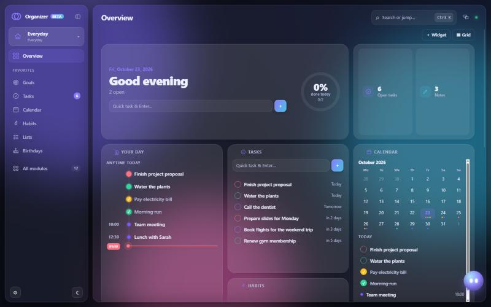
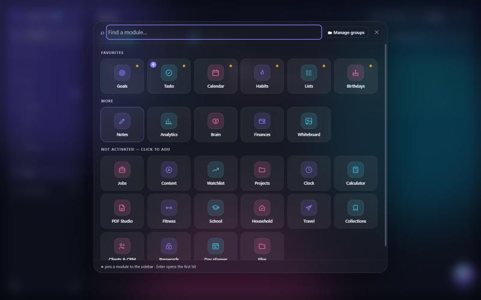
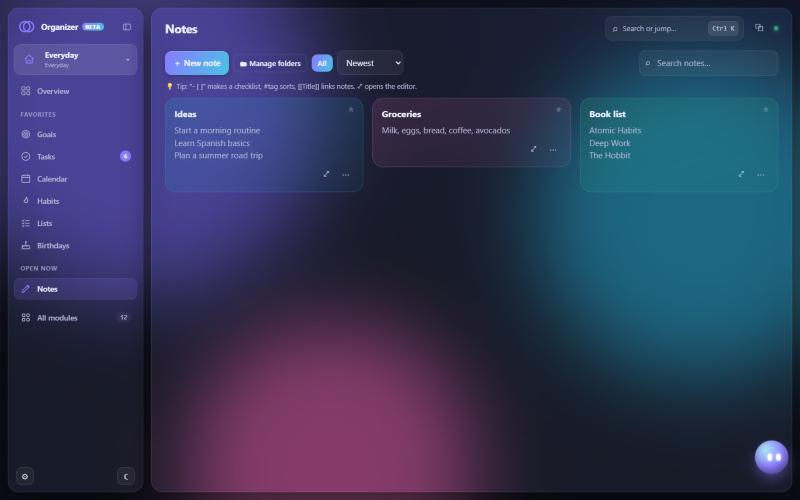

<h1 align="center">Organizer BETA</h1>

<b>Your life. One place.</b> A free, offline-first desktop app for Windows that brings tasks, calendar, notes, habits, goals, finances and 30+ more modules into one app.

  <a href="https://github.com/BlisFPS/organizer/releases/latest/download/Organizer-Setup.exe"><b>⬇ Download for Windows</b></a> ·
  <a href="https://blisfps.github.io/organizer/">Website</a> ·
  <a href="https://github.com/BlisFPS/organizer/issues/new?template=feedback.yml">Give feedback</a> ·
  <a href="https://discord.gg/ZYxPr8K5RZ">Discord</a>

## 🧪 This is a beta and I need your feedback

Organizer is a personal project and still in beta. I'd really like to know what you think:

- What do you like, and what feels confusing?
- Which modules do you use, and which are missing?
- Did you find a bug?

👉 **[Share your feedback](https://github.com/BlisFPS/organizer/issues/new?template=feedback.yml)** or **[join the Discord](https://discord.gg/ZYxPr8K5RZ)** and chat with me directly. I read every single message.

## ✨ Features

- **Profiles:** Everyday, Fitness, Studies, Household, Travel, Business, Content creator or your own. Each profile only shows the modules you choose.
- **37 modules:** Tasks, Calendar, Day planner, Notes, Whiteboard, Lists, Goals, Habits, Projects, Brain, Analytics, Birthdays, Countdowns, Pomodoro, Clock, Calculator, Finances, Watchlist, Jobs, Clients & CRM, Content, Links & News, Passwords, PDF Studio, Files, Health, Fitness, Medication, Water, School, Household, Shopping list, Vehicles, Travel, Packing lists, Collections and the Overview dashboard.
- **AI assistant (optional):** chat with Claude or OpenAI using your own API key to plan your day or create tasks.
- **Desktop extras:** automatic daily backups, Windows notifications in the background, system tray & autostart, file browser, screen time, pop-out windows that can stay on top, weather.
- **Personalize:** several designs, day and night mode, custom widgets, global search (Ctrl + K).
- **4 languages:** English, German, French, Spanish.

| | |
|---|---|
|  |  |

## 🔒 Privacy & data

- **Everything stays on your computer.** No account, no cloud, no Organizer server.
- **No tracking or telemetry.**
- **Backups** are plain JSON files in `Documents/Organizer-Backups` (one per day, kept for 30 days). Export and import at any time in Settings.
- **Optional online extras** only connect when you use them: weather (Open-Meteo), maps (OpenStreetMap), stock quotes, and the AI assistant (only with your own API key, which is stored encrypted by Windows).
- Your data is **kept when you uninstall**.

## 💾 Installation

1. Download **[Organizer-Setup.exe](https://github.com/BlisFPS/organizer/releases/latest/download/Organizer-Setup.exe)** (~96 MB).
2. Run it. Because the app isn't code-signed yet, Windows may show *“Windows protected your PC”*. Click **More info → Run anyway**.
3. Choose an install folder. A desktop shortcut and a Start menu entry are created.
4. Pick your language and a profile, and you're done.

**Requirements:** Windows 10 / 11 (64-bit).
